 

## <samp>~/about</samp>

  

- Full stack web apps, from the frontend to the Node.js / PHP backend
- Discord tools and panels, most of them open source here
- Game cheat development for 3.5+ years, together with the [ElitClub](https://www.elitclub.store/) team
- Linux on the desktop, security on the side

## <samp>~/stack</samp>

  

## <samp>~/projects</samp>

  
  
   
  
  

## <samp>~/game</samp>

<samp>A tiny capture the flag, played right here. Click your way in.</samp>

<b>&#9654; press start</b>

 
<samp>You land a shell on <b>sqbey-box</b>. A port scan shows three open ports. Pick one.</samp>
  

<samp>22/tcp &nbsp;ssh</samp>

 
<samp>&#10060; Key-only login, and you have no key. Dead end. Try another port.</samp>
  

<samp>80/tcp &nbsp;http</samp>

 
<samp>&#9989; A login page loads. What do you do?</samp>
  

<samp>try admin / admin</samp>

 
<samp>&#10060; Wrong password. Two more tries and you are banned. Think smarter.</samp>
  

<samp>view page source</samp>

 
<samp>&#9989; A forgotten comment: <code>&lt;!-- TODO: remove /backup before launch --&gt;</code> Inside /backup there are two files. Open one.</samp>
  

<samp>passwords.zip</samp>

 
<samp>&#10060; Encrypted. Cracking it would take about 400 years. Try the other file.</samp>
  

<samp>notes.txt</samp>

 
<samp>&#127937; You got it: <code>SQBEY{4lw4ys_r34d_th3_s0urc3}</code> <a href="https://github.com/SQbey/SQbey/issues/new?title=I+captured+the+flag">Open an issue</a> with the flag to claim your win.</samp>
  

<samp>3306/tcp &nbsp;mysql</samp>

 
<samp>&#10060; Access denied. The database only listens to localhost. Dead end.</samp>
  

## <samp>~/activity</samp>

  

  

  

  

